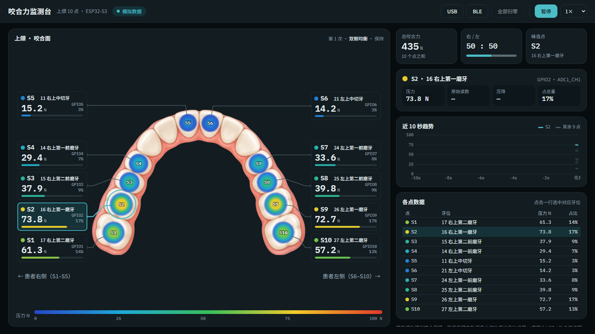
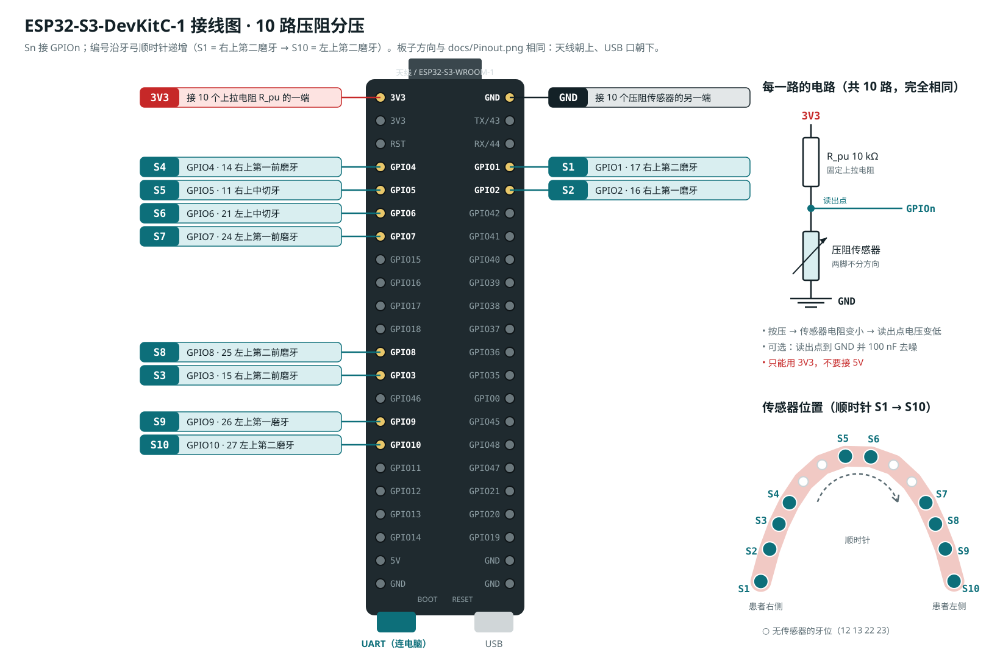
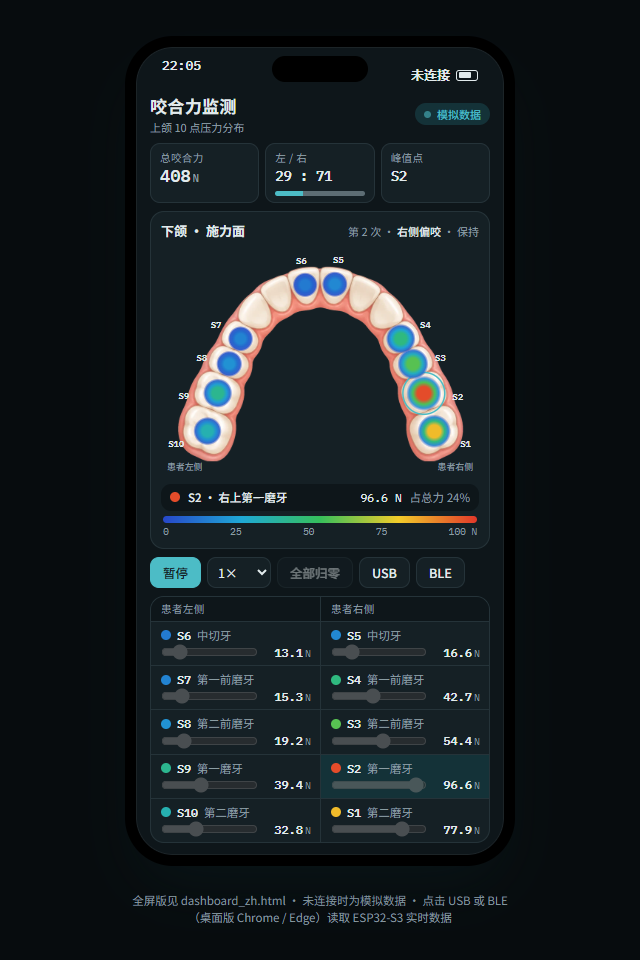
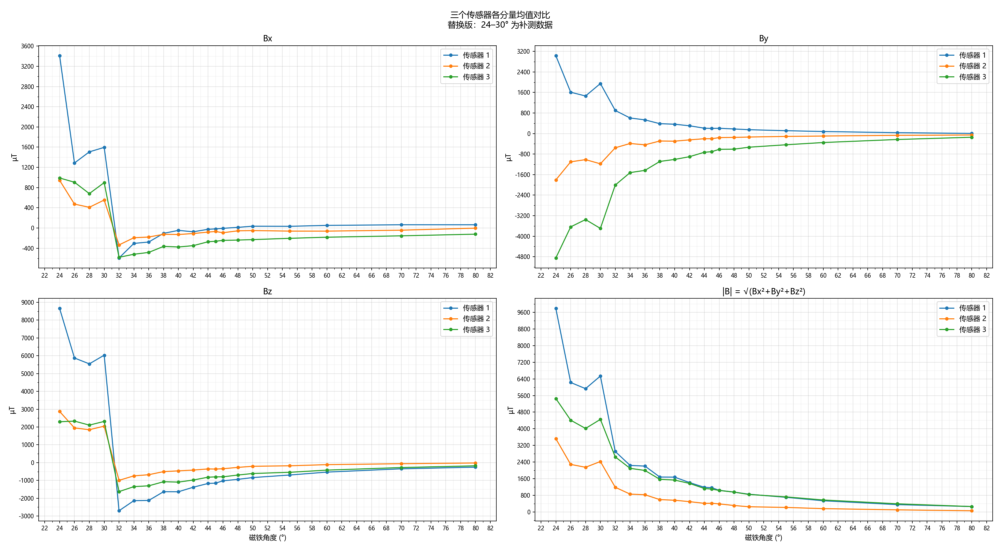
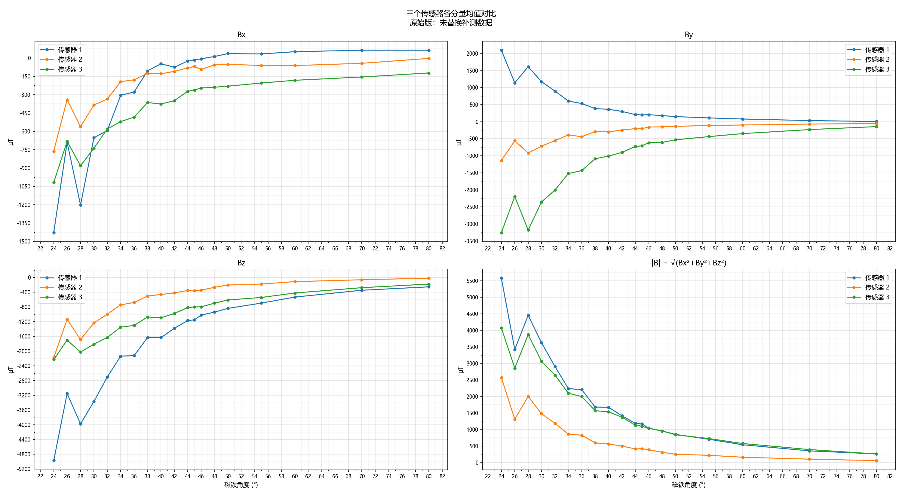

# Tooth_Trace_Rebuild · 牙模磁场轨迹重建

牙模相关的传感实验仓库，目前包含两部分：

1. **咬合力监测**：在上颌牙模的 10 个牙位上布置压阻传感器，由 ESP32-S3 采集各点分压，通过 USB 串口或 BLE 实时传到网页。网页用热力图和每点一张实时曲线显示，并可录制、导出 CSV。
2. **磁场角度测试数据分析**：3 个磁传感器在不同磁铁角度下的 Bx / By / Bz 采样数据，以及计算均值并作图的分析脚本。



## 目录结构

```
├── firmware/bite_force_esp32s3/   ESP32-S3 固件（Arduino）
├── ui_demo/
│   ├── dashboard_zh.html          全屏监测面板
│   ├── onescreen_zh.html          手机单屏版
│   ├── hw_link.js                 硬件连接层（Web Serial / Web Bluetooth，两个页面共用）
│   └── upper_arch*.webp           牙弓底图
├── docs/
│   ├── wiring.md                  接线说明（详细版）
│   ├── wiring_pinout.svg          接线引脚图
│   ├── Pinout.png                 ESP32-S3-DevKitC-1 官方引脚图
│   ├── esp32-s3_datasheet_en.pdf  ESP32-S3 数据手册
│   └── images/                    README 用截图
├── mag_csv_data/                  磁场原始数据（轨迹重建用）
└── analysis/                      磁场数据分析脚本及输出图
```

---

## 一、咬合力监测

### 硬件

| 项目 | 说明 |
|---|---|
| 主控 | ESP32-S3-DevKitC-1 |
| 传感器 | 压阻式压力传感器 × 10 |
| 传感器结构 | 叉指电极（小间距）+ 压阻层 |
| 上拉电阻 | 标称 49.9 kΩ × 10，每颗实际阻值不同，建议逐个实测（见下文） |
| 可选 | 10 nF 电容 × 10（读出点对 GND 滤波） |

### 接线

每个传感器一路独立分压，压阻传感器在下：

```
3V3 ──[ R_pu 49.9 kΩ ]──┬── GPIOn（读出点）
                        │
                   [ 压阻传感器 ]
                        │
                       GND
```

按压时传感器电阻变小，读出点电压下降。编号从 S1（右上第二磨牙）经过前牙到 S10（左上第二磨牙）。**Sn 接 GPIOn**，只用 ADC1 的通道，因为 ADC2 与无线电共用。

> 下面的接线图按面对患者的方向画，患者右侧在图左，编号是顺时针。网页里的牙弓做了左右镜像，患者右侧显示在屏幕右侧，所以屏幕上看编号是逆时针。两者对应的牙位相同。



| 传感器 | 牙位 (FDI) | 引脚 | | 传感器 | 牙位 (FDI) | 引脚 |
|---|---|---|---|---|---|---|
| S1 | 17 右上第二磨牙 | GPIO1 | | S6 | 21 左上中切牙 | GPIO6 |
| S2 | 16 右上第一磨牙 | GPIO2 | | S7 | 24 左上第一前磨牙 | GPIO7 |
| S3 | 15 右上第二前磨牙 | GPIO3 | | S8 | 25 左上第二前磨牙 | GPIO8 |
| S4 | 14 右上第一前磨牙 | GPIO4 | | S9 | 26 左上第一磨牙 | GPIO9 |
| S5 | 11 右上中切牙 | GPIO5 | | S10 | 27 左上第二磨牙 | GPIO10 |

- 10 个上拉电阻共同接到板子的 **3V3**，10 个传感器的另一端共同接到 **GND**。
- **不要接 5V**，GPIO 不耐 5V。
- 在 DevKitC-1 上，GPIO1、GPIO2 位于右排排针，其余 GPIO 在左排。各引脚的具体位置见上图或 [docs/wiring.md](docs/wiring.md)。

### 上拉电阻与传感器的注意事项

**逐个实测上拉电阻**：49.9 kΩ 只是标称值，同一批电阻之间也有差异。焊接前（或断开一端后）用万用表逐个测量，记下每一路的实测值。网页和固件都不用这个阻值计算，显示和 CSV 里的 mV 不受影响。但以后要用分压公式反推传感器电阻、做力值标定时，必须用每一路各自的实测值：

```
R传感器 = R_pu(实测) × V / (Vcc − V)
```

如果都按标称值算，每一路的误差会直接带进传感器电阻和力值里。

| 传感器 | S1 | S2 | S3 | S4 | S5 | S6 | S7 | S8 | S9 | S10 |
|---|---|---|---|---|---|---|---|---|---|---|
| R_pu 实测 (kΩ) | | | | | | | | | | |

**叉指电极小间距的影响**：上拉电阻是独立元件，阻值不会因为传感器结构而改变。会变的是传感器那一侧的等效电阻：

- 电极间距小，压阻层稍有接触就导通，空载电阻可能只有几百 kΩ，而不是接近开路，所以读出点空载电压会低于 3.3 V。例如空载 500 kΩ 时约为 3.3 × 500 / (500 + 49.9) ≈ 3.0 V；
- 湿气、汗液、助焊剂残留会在电极之间形成并联的漏电通路，让等效电阻继续变小，并随时间和环境漂移。保持电极干燥、清洁，每次测量前在不受力时重新调零。

**源阻抗较高时的 ADC 读数**：49.9 kΩ 比常见的 10 kΩ 大，ESP32 的 ADC 采样电容充电不足时，读数可能偏低，相邻通道也可能互相串扰（按一个点，旁边的点也跟着变）。可以在每个读出点对 GND 并一个 10 nF 电容（时间常数约 0.5 ms，不影响 200 Hz 采样）。不要用 100 nF，与 49.9 kΩ 组合的时间常数约 5 ms，会把快速变化抹平。

**核对方法**：量出某一路的 R_pu 和传感器在空载、按压时的电阻，用 `V = 3.3 × R传感器 / (R传感器 + R_pu)` 算出理论电压，再和网页上的读数比较。两者一致，说明电路正常；网页读数明显偏低或出现串扰，就按上一条处理。

### 固件

源码：[firmware/bite_force_esp32s3/bite_force_esp32s3.ino](firmware/bite_force_esp32s3/bite_force_esp32s3.ino)，只用 Arduino-ESP32 core 3.x 自带的库，不需要另装库。

1. Arduino IDE 安装 esp32 开发板包 3.x，开发板选 **ESP32S3 Dev Module**。
2. 用 USB 线连接电脑，选择对应的 COM 口：
   - 接 **UART** 口（CP2102）：保持默认设置即可；
   - 接 **USB** 口（原生 USB）：「工具 → USB CDC On Boot」必须选 **Enabled**，否则网页收不到串口数据。
3. 上传。如果连不上，按住 BOOT 键再点上传。

主要参数在文件开头：

| 常量 | 默认值 | 说明 |
|---|---|---|
| `PINS` | GPIO1–10 | S1–S10 对应的引脚 |
| `R_PU_OHM` | 49900 | 上拉电阻标称值，只在 `I` 信息行里上报，不参与任何计算。换电阻时同步修改；各路实测值记在上面的表里 |
| `FRAME_HZ` | 200 | 每秒发送的帧数 |
| `OVERSAMPLE` | 8 | 每路每帧的 ADC 平均次数 |
| `BAUD` | 921600 | 串口波特率，只对 UART 口有影响 |

**数据格式**

- 串口（文本，每行一条）：
  - `I,n=10,rpu=49900,vcc=3300,hz=200`：每 2 秒一次，说明通道数、上拉电阻标称值、电源电压和帧率；
  - `D,<t_ms>,<mv1>,…,<mv10>`：每帧一行，内容是板子运行时间（ms）和 10 个读出点的电压（mV）。
- BLE（设备名 `BiteForce`）：
  - 服务 UUID `8b1f0001-6c3e-4c2a-9f5e-2a7d0b1e4f10`；
  - `…0002` 通知：每帧 20 字节，即 10 个 uint16 小端 mV；
  - `…0003` 可读：参数字符串，内容同串口的 `I` 行。

### 界面

两个页面都是纯静态 HTML，用桌面版 **Chrome 或 Edge** 直接打开即可。Web Serial 和 Web Bluetooth 只有这两种浏览器支持。也可以在 `ui_demo/` 目录下执行 `python -m http.server`，再访问 `http://localhost:8000/dashboard_zh.html`。

| 全屏面板 `dashboard_zh.html` | 手机单屏 `onescreen_zh.html` |
|---|---|
| 左栏是牙弓热力图和摘要（总压降、左 / 右比例、峰值点）；右栏是 10 个点各自的近 10 秒实时曲线，左列为患者左侧（S6–S10），右列为患者右侧（S5–S1），上下顺序和牙齿的前后位置一致。顶栏可录制并导出 CSV | 手机竖屏布局，热力图加两列传感器列表（左列患者左侧，右列患者右侧），列表的上下顺序和牙齿的前后位置一致 |
|  |  |

两个页面的牙弓图都做了左右镜像：患者右侧（S1–S5）在屏幕右侧，患者左侧（S6–S10）在屏幕左侧。

使用流程：

1. 点 **USB**（选择 COM 口）或 **BLE**（选择 `BiteForce`）连接。标题旁的状态标签会显示 `实时 · USB · 200 Hz`，这是实测的帧率。收到第一帧数据之前，各点的电压显示为「—」。
2. 等电压显示出来后，在所有传感器都不受力时点 **调零**（英文界面为 **Tare**，作用见下文）。调零基准保存在浏览器里，下次打开仍然有效。
3. 全屏面板上点 **● 录制** 开始记录，再点 **■ 停止**，然后点 **导出 CSV**，按钮会短暂显示「✓ 已导出」。
   - 文件由浏览器保存到默认下载文件夹（Windows 上一般是 `C:\Users\<用户名>\Downloads`），文件名为 `bite_force_日期_时间.csv`，时间取点「录制」的那一刻。想换保存位置，在浏览器的下载设置里修改，或者打开"下载前询问保存位置"。
   - 录制会保存收到的每一帧（USB 下为 200 Hz），不受屏幕刷新率影响。
   - 断开连接时录制自动停止，已录数据仍可导出；单次最长 30 分钟。
4. 打开页面时不播放模拟数据，各点为 0。未连接硬件时，可以点 **播放** 演示模拟咬合循环，或在各点卡片里拖动滑块手动设置数值，方便单独调试界面。
5. 全屏面板右上角的 **EN / 中文** 按钮用于切换中英文，选择会被记住；也可以在链接后加 `?lang=en` 或 `?lang=zh` 直接指定语言。英文界面的牙位缩写为 UR（右上）、UL（左上）。

**显示的数值**：页面不使用传感器模型，直接显示分压读数。

- 每个点显示读出点电压（V）、原始读数（mV）和压降，并画出近 10 秒的电压曲线。10 张曲线图共用一个纵轴，范围随窗口内的电压自动缩放（至少 0.2 V），因此几百毫伏的变化也看得清；
- 热力图、总量、左右比例和峰值点都按**压降百分比**计算：`(基准电压 − 当前电压) / 3.3 V × 100%`。分母固定为 3.3 V，1 % 对应 33 mV。它与电压成线性关系，按压越用力数值越大；
- **基准电压**：点过「调零」后，是调零时各点各自的电压；没调零时为 3.3 V。ADC 空载最高只读到约 3.139 V，所以没调零时每个点不受力也会有约 4.9 % 的压降，建议连接后先调零。调零只影响压降和颜色，显示的电压、原始 mV 和 CSV 里的 mV 列都是真实读数。收到数据之前点调零无效；如果浏览器里存着全 0 的无效基准，打开页面时会自动丢弃；
- 颜色按**色标满量程**映射：连接硬件后，原来的播放速度下拉框换成满量程选择（5 / 10 / 20 / 50 / 100 %，默认 20 %），压降达到该值即显示为最红。轻压通常只有百分之几到十几的压降，满量程设成 100 % 时颜色几乎不变。可以先按一下看压降最多到多少，再选略高于它的一档；
- 显示时做了 40 ms 时间常数的平滑，平滑程度不随帧率变化。

**CSV 格式**：第一行是表头，之后每帧一行。

| 列 | 说明 |
|---|---|
| `t_ms` | 从录制开始起的时间（ms）。USB 用板子的时间戳；BLE 帧不带时间，用电脑收到数据的时间 |
| `S1_mV` … `S10_mV` | 各读出点电压，未经平滑的原始读数 |
| `S1_drop_pct` … `S10_drop_pct` | 按当时的调零基准算出的压降（%），保留 1 位小数 |

### 常见问题

- **所有通道一直是 3139 mV，按压也不变**：3139 mV 是 ADC 的满量程，说明读出点被拉到了 3.1 V 以上。请检查传感器的另一端是否真的接到了 GND，或者传感器按压时的电阻是否远大于上拉电阻（49.9 kΩ）。可以用杜邦线把某个 GPIO 直接接 GND，网页上对应的点应该变成 0 V。
- **上传失败 / 网页连不上串口**：同一个 COM 口同一时间只能被一个程序占用。上传前先在网页上点「断开」，或者关掉串口监视器。
- **BLE 帧率低于 200 Hz**：受 Windows 蓝牙连接间隔的限制，正常现象。需要满帧率时用 USB。
- **按压时颜色几乎不变**：先在不受力时调零，再把色标满量程调小（例如 10 % 或 5 %）。如果降到 0 V 压降仍显示 0 %，说明调零时传感器正在受力，不受力时重新调零即可。
- **连接后一直显示「—」或 `0 Hz · 等待数据`**：板子没有在发送数据。用原生 USB 口时确认「USB CDC On Boot」为 Enabled；也可以按一下板子上的 RST 键，再重新连接。
- **改了网页文件但界面没变**：浏览器还在用旧页面，按 Ctrl+F5 强制刷新。
- **空载电压明显低于 3.1 V，且各路不一样**：叉指电极空载时并非开路，加上各路上拉电阻实际阻值不同，空载电压本来就会有差异。调零后各点都从 0 % 起算；如果某一路空载电压一直在漂，检查电极表面是否受潮或有残留。
- **按一个点，相邻的点也跟着变**：上拉电阻较大时，ADC 通道之间可能串扰。在读出点对 GND 并 10 nF 电容，详见"上拉电阻与传感器的注意事项"。

### 尚未实现

- 力值标定：目前只显示电压和压降百分比，没有换算成 N。标定时需要用每一路各自实测的 R_pu。
- 手机单屏页还没有录制和导出功能。

---

## 二、磁场角度测试数据分析

### 数据

`mag_csv_data/` 下的文件按 `角度(传感器号).csv` 命名，例如 `24(1).csv` 表示 1 号传感器在磁铁 24° 时的数据。共 3 个传感器，角度为 24–50°（每 2°，含 45°）以及 55°、60°、70°、80°。

| 列 | 说明 |
|---|---|
| `epoch_ms`, `t_ms` | 时间戳（ms） |
| `Bx_uT`, `By_uT`, `Bz_uT` | 磁场三个分量（µT） |
| `dBx_uT` … `dBz_uT`, `Fx_N` … `Fz_N` | 采集程序输出的附加量，分析脚本暂不使用 |

传感器读取失败时会写入 `(-1, -1, -1)`，分析时会剔除这些行。`TDF_20260919_151210.csv` 不符合命名规则，分析时会跳过。

24–30° 有两批数据：`mag_csv_data/` 里的 12 个同名文件已换成补测数据（来源是 `data补测/`），替换前的原始文件保存在 `data原始/`。补测的 Bx、Bz 与 32° 及以后的数据符号相反，|B| 也相差约一倍，两批的测量条件可能不同，合并使用前需要先确认。

### 分析脚本

```bash
pip install pandas numpy matplotlib
python analysis/plot_angle_means.py
```

脚本输出两个版本，分别在 `analysis/output/replaced/`（24–30° 用补测数据）和 `analysis/output/original/`（24–30° 用原始数据），每个目录下都有：

- `summary_means.csv`：每个传感器在每个角度下各分量的均值和标准差，以及 |B| 的均值和标准差；
- `by_sensor.png`：每个传感器的 Bx / By / Bz 随角度变化（误差棒为 ±1 std）；
- `by_component.png`：3 个传感器按分量对比。

| 替换版 | 原始版 |
|---|---|
|  |  |

---

## 参考资料

- [ESP32-S3-DevKitC-1 官方引脚图](docs/Pinout.png)
- [ESP32-S3 数据手册](docs/esp32-s3_datasheet_en.pdf)
- [详细接线说明](docs/wiring.md)
