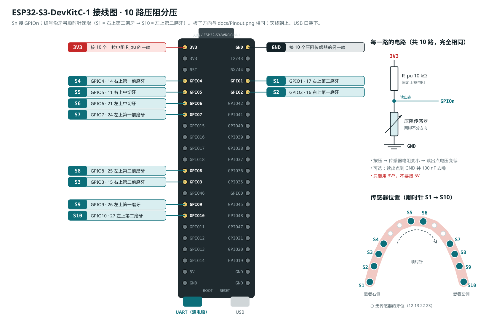

# 接线说明：ESP32-S3-DevKitC-1 + 10 路压阻传感器

## 单路电路

每个传感器一套分压电路，压阻传感器（FSR）在下：

```
3V3 ──[ R_pu 10 kΩ ]──┬── GPIOn（ADC 读出点）
                      │
                      ├──[ 100 nF ]── GND   （可选，滤波）
                      │
                   [ FSR 压阻 ]
                      │
                     GND
```

- 压力越大 → FSR 电阻越小 → 读出点电压越低。
- 不受力时 FSR 接近开路，读出点约 3.3 V，超出 ADC 量程（11 dB 衰减约 3.1 V），程序按"无压力"处理。
- R_pu 取传感器常用工作区电阻的中间值。FSR402 / RP-C 类薄膜传感器用 10 kΩ 合适；换了阻值要同时改固件里的 `R_PU_OHM`。

## 引脚对应（只用 ADC1，ADC2 与无线电冲突）



编号沿牙弓顺时针递增（按界面上的牙弓图看）：从右上第二磨牙开始，经过前牙，到左上第二磨牙结束。Sn 接 GPIOn。

| 传感器 | 牙位 (FDI) | 开发板引脚 | ADC 通道 |
|---|---|---|---|
| S1  | 17 右上第二磨牙  | GPIO1  | ADC1_CH0 |
| S2  | 16 右上第一磨牙  | GPIO2  | ADC1_CH1 |
| S3  | 15 右上第二前磨牙 | GPIO3  | ADC1_CH2 |
| S4  | 14 右上第一前磨牙 | GPIO4  | ADC1_CH3 |
| S5  | 11 右上中切牙   | GPIO5  | ADC1_CH4 |
| S6  | 21 左上中切牙   | GPIO6  | ADC1_CH5 |
| S7  | 24 左上第一前磨牙 | GPIO7  | ADC1_CH6 |
| S8  | 25 左上第二前磨牙 | GPIO8  | ADC1_CH7 |
| S9  | 26 左上第一磨牙  | GPIO9  | ADC1_CH8 |
| S10 | 27 左上第二磨牙  | GPIO10 | ADC1_CH9 |

在 DevKitC-1 上：GPIO4–7、GPIO3、GPIO8–10 在左排排针；GPIO1、GPIO2 在右排上方（TX/RX 下面）。电源用左排顶部的 **3V3**，地用任一 **GND**。

## 接线步骤

1. 10 个 R_pu 一端全部接到 3V3（可在面包板上做一条 3V3 母线）。
2. 每个 R_pu 另一端 = 读出点，接对应 GPIO，同时接该路 FSR 的一端。
3. 10 个 FSR 的另一端全部接 GND 母线。
4. （可选）每个读出点对 GND 并一个 100 nF 电容，降低噪声。

注意：
- 电源只能用 3V3，**不要接 5V**，GPIO 不耐 5V。
- GPIO3 是 strapping 引脚，在默认 eFuse 配置下不影响启动；如果遇到启动异常，先把 S3 拔掉试一下。
- 传感器引线尽量短，长线时加滤波电容效果更明显。

## 烧录与使用

1. Arduino IDE 安装 esp32 开发板包（3.x），开发板选 **ESP32S3 Dev Module**。
2. 打开 `firmware/bite_force_esp32s3/bite_force_esp32s3.ino`，用板子上标 **UART** 的 USB 口连接电脑并上传。
3. 用桌面版 Chrome 或 Edge 打开 `ui_demo/dashboard_zh.html`（全屏面板）或 `ui_demo/onescreen_zh.html`（手机单屏）。可以直接双击打开，或在 `ui_demo` 目录执行 `python -m http.server` 后访问 `http://localhost:8000/dashboard_zh.html`。
4. 点击 **USB**（选择对应串口）或 **BLE**（选择 `BiteForce`）。用 BLE 时串口线可只用于供电。
5. 传感器不受力时点击 **调零 / Tare**，然后逐个按压，确认 S 编号与牙位对应。

## 数据格式与标定

- 串口 921600 波特（只对 UART 口有意义，原生 USB 口不受波特率限制）：`I,n=10,rpu=10000,vcc=3300,hz=200`（每 2 s）和 `D,<t_ms>,<mv1>,…,<mv10>`（200 Hz，每路每帧 8 次平均）。
- BLE 每帧一个通知，Windows 下连接间隔可能使实际帧率低于 200 Hz，页面右上角会显示实测值。
- BLE：服务 `8b1f0001-6c3e-4c2a-9f5e-2a7d0b1e4f10`，数据特征 `…0002` 通知 10 × uint16 小端 mV，信息特征 `…0003` 可读。
- 换算在 `ui_demo/hw_link.js`：`R = R_pu·V/(Vcc−V)`，`G = 1/R`（µS），`F = k·(G − G0)^b`。目前 `k = 0.1、b = 1` 只是相对值。
- 标定：在每个传感器上放已知砝码，在浏览器控制台用 `HW.raw().G` 读电导，拟合出 `k`、`b` 后执行 `HW.setCal({ k: [...10 个], b })`，结果保存在浏览器里。
